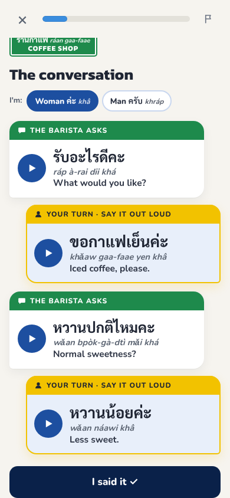
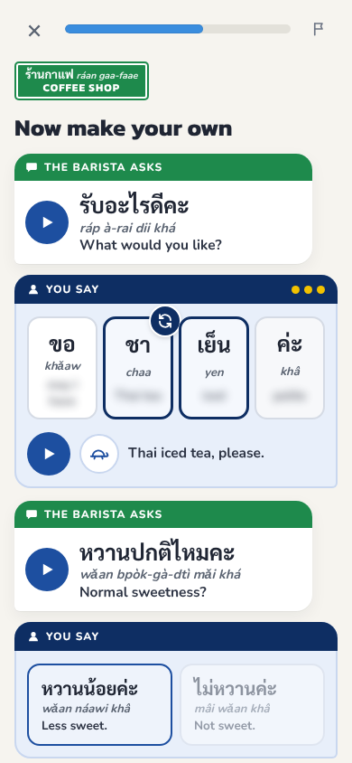
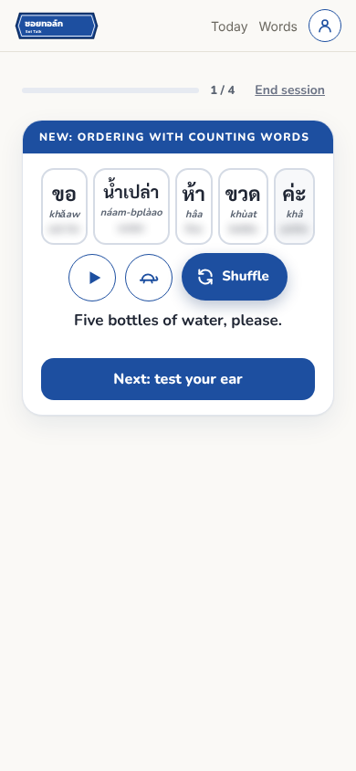

# Soi Talk

**Thai you'll use today.** A web app for people living in Thailand. Each day is one short lesson built around a real moment, like ordering coffee, bargaining at the market or telling a taxi where to stop, plus a line to go and say to someone that same day.

Live: https://soitalk.app (public launch 1 Nov 2026)

<p>
  
</p>
<p>
  
  
  
  
</p>

## Why I'm building it

I live in Bangkok. I took Thai classes, and the classes were fine. Practising at home was the problem. Most apps teach random travel phrases, or hand you a word list with no context.

What I wanted was simpler: learn the thing I'll need at the coffee stall tomorrow, hear it from a Thai voice, then actually say it. So I built that.

I spent about 15 years in English teaching and EdTech, including a platform launch for 2.5 million learners in China. This time I'm building the product myself.

## What works today

- **10 daily lessons, 2 to 3 minutes each.** 7-Eleven, a restaurant, a café, a drinks stall, the market, asking someone to slow down, finding the bathroom, a taxi, small talk and bargaining. Each lesson goes:
  - recall yesterday's line
  - hear the conversation
  - say your part out loud
  - learn it word by word
  - make your own version by swapping a word
  - a listening test
  - one line to say for real that day
- **Woman or man.** You pick once. Every line, ending and voice follows it (ค่ะ / ครับ, ฉัน / ผม), because Thai changes with who's speaking.
- **One finish line a day.** The lesson is the day. When it's done, Today says so and stays done. Extra practice is there if you want it, never as a new goal.
- **1,083 words in learner order.** Survival words first, everyday Thai next, formal and news Thai last. Browse by topic, or let Today pace them for you: 5 new words a day plus spaced reviews.
- **Example sentences you can work out.** Every word card has a sentence. Any word you haven't met yet is underlined and tappable for its meaning, so no card is a dead end.
- **Build sentences.** Sentence patterns (likes and dislikes, ordering with counting words) in 3 levels. One Shuffle button builds a new sentence, and a listening round checks you understood it.
- **Memory tracked over time, not taps.** Each word has a memory strength based on FSRS, the open scheduling algorithm Anki uses. Only listening checks make a word stronger, and a right answer after a long gap counts for more than one a few minutes later.
- **Real Thai audio** with a slow mode, from ElevenLabs, cached after the first play.
- **Street meter and progress.** After practice, a pop-up shows how much everyday Thai you'd understand today. The week strip uses Thailand's colours of the day instead of a streak flame.
- **Accounts that work inside Instagram.** Study without signing up. Save progress with Google, or with a 6-digit email code, which also works in Instagram's in-app browser where Google sign-in is blocked.
- **Report a mistake.** A small flag on every lesson and card sends a note straight to me.

Next up: a quick practice round you can do any time, replaying past lessons, a classifier game (Thai counting words), a tones lesson, and a Bangkok map of places you've learned to handle.

## How I make product decisions

I run every feature past a panel of AI reviewers before I build it: a learning scientist, a Thai teacher, an expat customer, a product designer and a technical lead. Each gives a verdict and a ranked list of changes. I make the call. The reviews and decisions live in a project log.

A few rules came out of that process:

- **Hook, retain, reward.** Every feature has to do at least one: a win in the first minute, a reason to come back tomorrow, or something real you can now say.
- **The lesson is the day.** One clear finish line. Optional practice never shows up as a new goal.
- **Remove before you add.** One main action per screen.
- **Never show anything unbuilt.** No "coming soon".
- **No gamification.** No points, leagues or guilt. Missing a day costs nothing.
- **Fit the screen and don't jump.** Every screen is checked by automated browser tests at two phone sizes and two laptop sizes before release: no scrolling to reach the main button, nothing sticking out, nothing moving when you answer.
- **At least 4 choices** in every quiz and sentence builder, and no alcohol as a default option.

## Where the content comes from

The word list is my own. I cross-referenced three Thai word-frequency lists, kept the most common words, then added the classifiers, function words and everyday phrases that basic sentences need but frequency lists miss. Older versions of the CU-TFL (Chulalongkorn University's Test of Thai as a Foreign Language) are a reference for what a learner should be able to do at each level.

Words and sentences live in one Excel workbook. An import script loads it into the database, so content changes never touch the code. Lessons and sentence patterns are written in code and checked by a Thai teacher.

Some example sentences were drafted with AI help. Every sentence has a review status, and native Thai review is ongoing. Rejected sentences never reach the app.

## How it's built

I built this with AI coding tools (Claude). I made the product, curriculum and design decisions, wrote the specs, and reviewed and tested each change.

| Part | Tool | Why |
| --- | --- | --- |
| Website | Next.js 14 (React) | Pages and small server functions in one codebase |
| Database and accounts | Supabase (Postgres) | Words, sentences, sign-in, progress and feedback, with row-level security |
| Audio | ElevenLabs API | The most natural Thai voices I tested (against Google Cloud and Botnoi) |
| Analytics | PostHog | Which lessons people finish and where they drop off |
| Hosting | Vercel | Deploys straight from this repo |
| Content | Excel workbook + Node import script | The spreadsheet stays the source of truth |
| Testing | Playwright | Automated walk-throughs of every lesson and screen at phone and laptop sizes |

How the data fits together:

- `vocabulary`: one row per word (Thai, romanization, English, frequency rank, topic, course order)
- `sentences`: one row per example sentence, with its review status
- `word_sentences`: links words to the sentences they appear in
- `profiles`, `word_progress` (memory strength per word), `study_days`, `said_it`: each user's settings and progress, readable only by that user
- `feedback`: mistake reports. Anyone can send one, nobody can read them through the app.

The public website can only read course content. Only the import script, run with a private key, can change it. The audio endpoint only speaks text that is in the course, so it can't be used to run up the ElevenLabs bill.

## Run it locally

```bash
npm install
cp .env.example .env.local   # then add your own Supabase and ElevenLabs keys
npm run dev                  # opens at http://localhost:3000
```

Create the tables by running the files in `supabase/` (001 to 010) in order in the Supabase SQL editor, then load the content:

```bash
node scripts/import-curriculum.js path/to/your-workbook.xlsx
```

Run the automated checks (they use a pretend database, so no keys are needed):

```bash
npm test
```

Keys go in `.env.local`, which is never committed. On Vercel they are set as encrypted environment variables.

## About me

I'm Jason Pshyk, a strategy and operations lead based in Bangkok, with an MBA and a PMP. Soi Talk is my side project. Feedback is welcome: jasonpshyk@gmail.com
