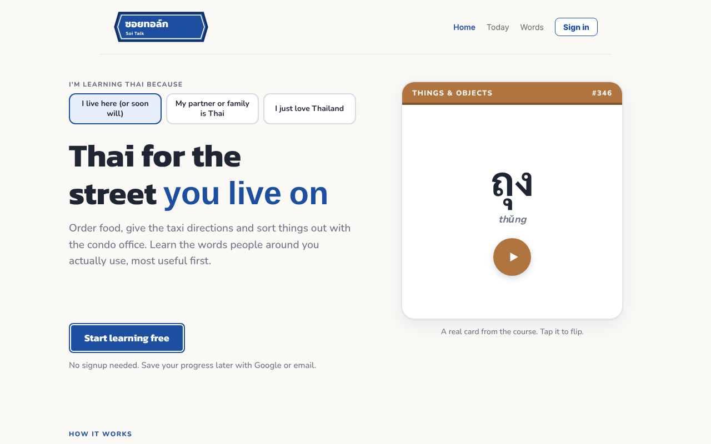
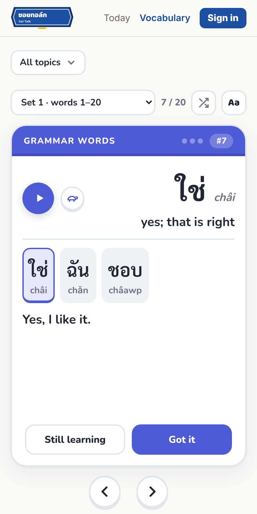
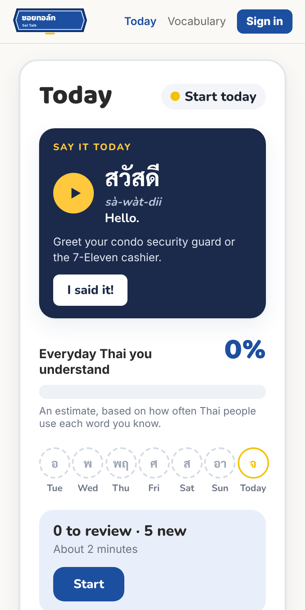

# Soi Talk

**Thai for your street.** A web app that teaches the Thai people around you actually use, most useful words first.

Live (beta): https://thai-study-companion.vercel.app

<p>
  
  
  
</p>

## Why I'm building it

I live in Bangkok. I took Thai classes, and the classes were fine. Practising at home was the problem. Most apps teach random travel phrases, or hand you a list to memorise with no context.

So I built the app I wanted: start with the most common words, show every word in a sentence you can actually understand, and hear it from a Thai voice. Then go and say something to a real person that day.

I spent about 15 years in English teaching and EdTech, including a platform launch for 2.5 million learners in China. This time I'm building the product myself.

## What works today

- **1,083 words in learner order.** Survival words and phrases first (greetings, food, getting around), everyday Thai next, formal and news Thai last. Every card shows which topic it belongs to, and you can study one topic at a time.
- **Sentences that only use words you've met.** Each card's example sentence is built from earlier words in the course, so you can always work it out. Tap any word in the sentence to hear it on its own.
- **Real Thai audio.** Every word and sentence can be played, with a slow mode. Audio comes from ElevenLabs and is cached after the first play.
- **Today screen.** A short listening check on words you've met before, then 5 new words a day (you can pick 10 to 30).
- **Memory tracked over time, not taps.** Each word has a memory strength based on FSRS, the open scheduling algorithm Anki uses. Only listening checks (hear it, pick the meaning from 5, no sound-alike options) make a word stronger, and a right answer after a long gap counts far more than one a few minutes later. A word is "known" once you'd very likely still recognise it three weeks later and you've proved it after a gap of a week or more.
- **Say it Today.** One short line a day to say out loud to someone real, like the condo guard or a taxi driver, and an "I said it!" button.
- **Street meter.** An estimate of how much everyday Thai you'd understand right now: each word counts by how often Thai people use it and how likely you are to remember it today.
- **Thailand's colours of the day.** The week strip uses the traditional colour for each day (yellow Monday, pink Tuesday and so on) instead of a streak flame.
- **Accounts.** Study without signing up. Sign in with Google or email to keep your progress on every device.

Still to build: listening practice at real speed, a sentence "pattern machine", real-life missions, a tones lesson, and iOS and Android versions.

## Where the content comes from

The word list is my own. I cross-referenced three Thai word-frequency lists, kept the most common words, then added the classifiers, function words and everyday phrases that basic sentences need but frequency lists miss. Older versions of the CU-TFL (Chulalongkorn University's Test of Thai as a Foreign Language) are a reference for what a learner should be able to do at each level.

Everything lives in one Excel workbook. An import script loads it into the database, so content changes never touch the code.

Some example sentences were drafted with AI help. Every sentence has a review status, and a native Thai review of the first stage is in progress. Rejected sentences never reach the app.

## Product decisions

- **Most useful first, not alphabetical or by textbook chapter.** The first few hundred words cover a big share of everyday speech, so the order matters more than the total.
- **No gamification.** No points, leagues or guilt. Missing a day costs nothing. The goal is a calm habit, and saying something real to a real person.
- **Textbook-safe forms on the cards.** Casual Thai often differs from the textbook (เรา is often an informal "I", not just "we"). Cards teach the safe form, and the differences are being collected for a later "real talk" section.
- **ครับ / ค่ะ explained once.** Example sentences leave the polite particle off, and a one-time tip tells you which one to add.
- **Tones later.** A small tip on day 2 points out the tone marks. A proper tones lesson comes after the first stage, once you have words to hang it on.
- **ElevenLabs for audio.** I compared Thai voices from Google Cloud, Botnoi and ElevenLabs by ear. ElevenLabs sounded the most natural.

## How it's built

I built this with AI coding tools (Claude). I made the product, curriculum and design decisions, wrote the specs, and reviewed and tested each change.

| Part | Tool | Why |
| --- | --- | --- |
| Website | Next.js 14 (React) | Pages and small server functions in one codebase |
| Database and accounts | Supabase (Postgres) | Words, sentences, sign-in and progress, with row-level security |
| Audio | ElevenLabs API | The most natural Thai voices I tested |
| Hosting | Vercel | Deploys straight from this repo |
| Content | Excel workbook + Node import script | The spreadsheet stays the source of truth |

How the data fits together:

- `vocabulary`: one row per word (Thai, romanization, English, frequency rank, topic, course order)
- `sentences`: one row per example sentence, with its review status
- `word_sentences`: links words to the sentences they appear in, and marks each card's chosen sentence
- `profiles`, `word_progress` (memory strength per word), `study_days`, `said_it`: each user's settings and progress, readable only by that user

The public website can only read course content. Only the import script, run with a private key, can change it. The audio endpoint only speaks text that is in the course, so it can't be used to run up the ElevenLabs bill.

## Run it locally

```bash
npm install
cp .env.example .env.local   # then add your own Supabase and ElevenLabs keys
npm run dev                  # opens at http://localhost:3000
```

Create the tables by running the files in `supabase/` (001 to 009) in order in the Supabase SQL editor, then load the content:

```bash
node scripts/import-curriculum.js path/to/your-workbook.xlsx
```

Keys go in `.env.local`, which is never committed. On Vercel they are set as encrypted environment variables.

## About me

I'm Jason Pshyk, a strategy and operations lead based in Bangkok, with an MBA and a PMP. Soi Talk is my side project. Feedback is welcome: jasonpshyk@gmail.com
